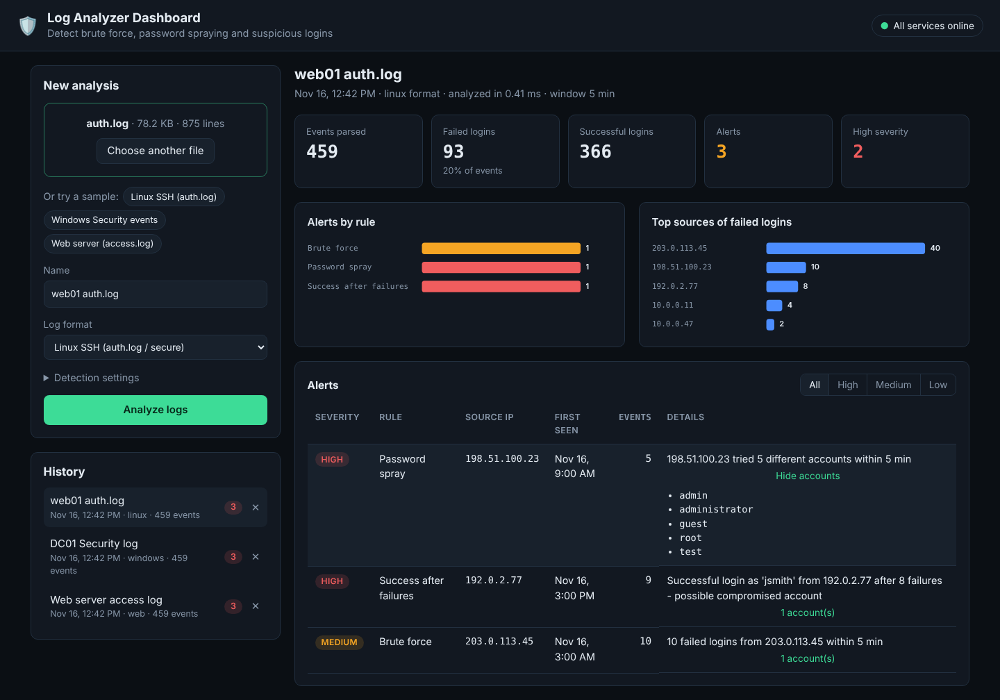
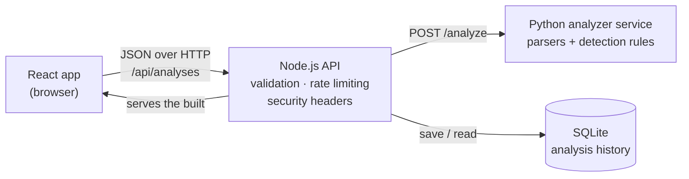

# Log Analyzer Dashboard

[](https://github.com/Cyril-419/log-analyzer-dashboard/actions/workflows/ci.yml)

A full-stack web app for my [Security Log Analyzer](https://github.com/Cyril-419/Security-Log-Analyzer). Upload a Linux, Windows or web server log and see the brute-force attacks, password sprays and suspicious logins it contains, with every analysis saved so you can come back to it.

**Stack:** React 19 + TypeScript · Node.js REST API (TypeScript) · SQLite · Python analysis microservice · Playwright end-to-end tests · GitHub Actions CI



## Architecture



Three pieces, each with one job:

| Service | Responsibility |
|---|---|
| **React frontend** (`web/`) | Upload logs, tune detection thresholds, view results and history |
| **Node.js API** (`server/`) | Public API: validates input, calls the analyzer, stores results, serves the frontend |
| **Python analyzer** ([separate repo](https://github.com/Cyril-419/Security-Log-Analyzer)) | Parses logs and runs the detection rules; stateless |

The browser never talks to the Python service directly. The Node API is the only public entry point: it validates every request, enforces size and rate limits, and checks the analyzer's responses too before trusting them. This is the same gateway-in-front-of-services pattern used in larger service-oriented systems.

## Features

- **Upload or drag and drop** a log file, or try one of three built-in samples
- **Auto-detects** Linux SSH (`auth.log`), Windows Security events (4624/4625) and Apache/Nginx access logs
- **Tunable detection settings**: time window and the threshold for each rule
- **Results view**: summary cards, alerts by rule, top attacking IPs, and an alerts table you can filter by severity, with the accounts each attacker tried
- **History**: every analysis is saved in SQLite and survives restarts; reopen or delete any of them
- **Service status** indicator showing whether the API and the analyzer are reachable

## REST API

| Method | Path | Description |
|---|---|---|
| `GET` | `/api/health` | Status of the database and the analyzer service (`503` if either is down) |
| `GET` | `/api/analyses` | Saved analyses, newest first (`?limit=` up to 200) |
| `POST` | `/api/analyses` | Run a new analysis and save it. Returns `201` with a `Location` header |
| `GET` | `/api/analyses/:id` | One analysis with its full results |
| `DELETE` | `/api/analyses/:id` | Delete an analysis (`204`) |

```bash
curl -X POST localhost:3000/api/analyses \
  -H "Content-Type: application/json" \
  -d '{"name": "web01", "format": "linux", "logs": "Nov 16 09:00:01 web01 sshd[1]: Failed password for root from 203.0.113.9 port 22 ssh2", "thresholds": {"brute_force_failures": 10}}'
```

## Security design

| Risk | What the app does |
|---|---|
| Malicious or malformed input | Every request body is validated with a strict **zod** schema: unknown fields, wrong types and out-of-range values are rejected with a clear `400` |
| Huge uploads (denial of service) | Bodies over **5 MB** are refused with `413`, checked before and while reading |
| Request flooding | **Rate limit** of 30 new analyses per minute per client (`429` with `Retry-After`) |
| Cross-site scripting | React escapes all rendered text, plus a strict **Content-Security-Policy** that only allows scripts and requests from the same site |
| Clickjacking / MIME sniffing | `X-Frame-Options: DENY`, `frame-ancestors 'none'`, `X-Content-Type-Options: nosniff` |
| SQL injection | All queries use **parameterized statements** |
| Path traversal | Static files are resolved and checked to stay inside the build folder |
| Untrusted upstream service | The analyzer's responses are **schema-validated** before being saved or shown |
| Information leaks | Unexpected errors return a generic `500`; stack traces stay in the server log |
| Exposure | Binds to `127.0.0.1` by default |

Each of these has a test in `server/test/`.

## Running it locally

Needs **Node.js 22.18+** and **Python 3.10+**.

```bash
# Terminal 1: the analyzer service
git clone https://github.com/Cyril-419/Security-Log-Analyzer
cd Security-Log-Analyzer
python -m loganalyzer serve                # http://127.0.0.1:8080

# Terminal 2: the dashboard
git clone https://github.com/Cyril-419/log-analyzer-dashboard
cd log-analyzer-dashboard
npm install
npm run build
npm start                                  # http://127.0.0.1:3000
```

For development, `npm run dev` rebuilds the frontend and restarts the server whenever a file changes.

| Setting | Default | Purpose |
|---|---|---|
| `PORT` / `HOST` | `3000` / `127.0.0.1` | Where the dashboard listens |
| `ANALYZER_URL` | `http://127.0.0.1:8080` | Where the Python service is running |
| `DB_PATH` | `data/dashboard.db` | SQLite file |
| `MAX_BODY_MB` | `5` | Upload limit |
| `RATE_LIMIT_PER_MINUTE` | `30` | New analyses per client per minute (`0` turns it off) |

## Tests and CI

```bash
npm run typecheck   # strict TypeScript across server, shared types and React app
npm test            # 29 API tests
npm run test:e2e    # 8 browser tests (needs the analyzer running and `npm run build`)
```

- **API tests** run the real HTTP server on a random port with a fake analyzer, covering every route, every validation rule, the security headers, path traversal, rate limiting, and what happens when the analyzer is down, slow or returns bad data.
- **End-to-end tests** use **Playwright** to drive the real UI in Chromium against the real Node API and the real Python analyzer: loading a sample, checking the detected attacks, filtering, changing thresholds, reloading to confirm history is saved, uploading a broken file, and deleting. The last test fails if the browser logged any JavaScript error or CSP violation.

**GitHub Actions** runs on every push and pull request: type-check, API tests and build first; then a second job checks out the Python analyzer from its own repo, starts it as a service, and runs the browser tests against the full stack.

## Project layout

```
server/          Node.js API (TypeScript, runs directly on Node 22)
  app.ts           routes, validation, security headers, static files
  analyzerClient.ts  calls the Python service, with timeouts and error mapping
  db.ts            SQLite storage (node:sqlite)
  rateLimit.ts     per-client rate limiter
  validation.ts    zod schemas for requests and analyzer responses
  test/            API tests (node:test)
web/             React frontend
  src/components/  upload form, summary cards, SVG charts, alerts table, history
  public/samples/  sample logs
shared/types.ts  types used by both the API and the frontend
e2e/             Playwright browser tests
scripts/build.mjs  esbuild build for the frontend
```

## Design decisions

- **Small dependency footprint.** The app has three runtime dependencies (React, React DOM, zod). The API uses Node's built-in HTTP server, SQLite module and test runner, and charts are plain SVG. Fewer packages means a smaller supply-chain attack surface and less to keep patched.
- **Shared types.** `shared/types.ts` is imported by both the API and the React app, so a change to the data shape is caught by the type checker on both sides.
- **The analyzer stays stateless.** Storage belongs to the API; the Python service just turns logs into alerts. Either side can be scaled or replaced on its own.

## Ideas for next versions

- Docker Compose to start all three services with one command
- Login and per-user history
- Charts of failed logins over time
- Export results as CSV or PDF
